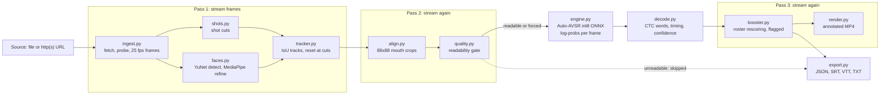

# Architecture

LipRead is a Python package (`lipread`, src layout). One pipeline function does the
work, and two front ends call it: the CLI and the local web UI. Nothing else touches
the model.

```
lipread run / lipread serve  ->  pipeline.run(job)  ->  Result  ->  export + render
```

## Pipeline



Every stage that needs video reads it through `ingest.iter_frames`, so the pipeline
never holds all full-resolution frames of a clip in memory.

## Streaming passes

| Pass | Reads video for | Keeps in memory |
|---|---|---|
| 1 | Shot cuts, face detection, keypoint refinement | Small per-frame detections and keypoints |
| 2 | Cutting 88x88 mouth crops for every kept track (quality gate and model run follow, outside the frame loop) | Crops for all kept tracks (~7.7 KB per frame per track); full frames are never stored |
| 3 | Rendering the annotated video | One frame at a time |

## Module responsibilities

| Module | Responsibility |
|---|---|
| `types.py` | Shared dataclasses: `VideoInfo`, `Detection`, `FaceTrack`, `QualityReport`, `Word`, `Utterance`, `TrackResult`, `Job`, `Result`. Constants: 25 fps, 88 px crop, 400-frame windows with 50-frame overlap. |
| `ingest.py` | Download or open the source, probe it, stream 25 fps frames, count frames, extract audio (for later audio-visual work). |
| `shots.py` | Detect shot cuts so tracks never cross a cut. |
| `faces.py` | YuNet finds small faces; MediaPipe refines five-point landmarks into the four alignment points on an upscaled crop. |
| `tracker.py` | Link detections into one track per person, inside a shot (IoU matching, short gaps allowed). |
| `align.py` | Ported Auto-AVSR preprocessing: smooth keypoints, affine-align the face, cut the mouth patch. Constants must not change without re-running the benchmark. |
| `quality.py` | Score each track: face size, yaw, blur, mouth motion, coverage. Assign `readable`, `marginal` or `unreadable`, with reasons. |
| `engine.py` | The `Engine` protocol and the Auto-AVSR int8 ONNX implementation. Also `stitch_windows`, which joins overlapping model windows on their posteriors. |
| `decode.py` | Turn log-probs into words with start, end and confidence (greedy CTC), then split into utterances. |
| `booster.py` | Re-score word candidates against the roster (names you pass in). Boosted words are marked and keep the model's original word. |
| `export.py` | Write JSON, SRT, WebVTT and TXT. |
| `render.py` | Draw an annotated video: boxes, labels, confidence, neon overlay. |
| `models.py` | Model manifest, license gate, download, and the models folder. |
| `pipeline.py` | `run(job, engine=None, progress=None) -> Result`. Orchestrates all the stages above. |
| `cli.py` | `lipread scan`, `run`, `models`, `serve`. |
| `web/server.py` | FastAPI app that runs jobs through `pipeline.run` and serves `web/static/index.html`. |
| `errors.py` | `LipReadError`, the one error type the rest of the code raises. |

## Engine interface

The pipeline only uses four things from an engine:

```python
class Engine(Protocol):
    vocab: list[str]    # index -> piece; "▁" marks the start of a word
    blank: int          # index of the CTC blank
    info: dict          # name, version, license note, providers
    def logprobs(self, crops: np.ndarray) -> np.ndarray:
        """crops: uint8 (T, 88, 88) at 25 fps. Returns float32 (T, len(vocab))."""
```

To add a model (a stronger one, or a fine-tuned sports model), write a class with these
four members. Nothing else in the pipeline needs to change. Rules for a new engine:

- Keep the 25 fps and 88x88 contract, or add a preprocessing step inside the engine.
- Put the license in `info["license"]`. It shows in every result.
- Test it against `StubEngine` first, then run the benchmark in `eval/`.

`StubEngine` is a deterministic fake for tests. It emits a fixed word script, so timing,
windowing and export can be tested without the model download.

## Design decisions

- **Visual only in v0.1.** The model reads lips from pixels. Audio is not used yet.
- **Detection finds small faces.** YuNet is kept for small faces. MediaPipe alone lost faces at 120 px and below in our test, missing faces
  below about 150 px, so it refines keypoints on an upscaled crop instead of finding faces.
- **Stitch on posteriors, not text.** Overlapping windows are merged before decoding, so words
  are not duplicated or cut at a seam.
- **Booster is ours.** The pyctcdecode hotword option duplicated words, so the roster booster
  rescoring is written in this repo.
- **No Gradio.** The web UI is a small custom page, so it can match the app's look.
- **Weights are downloaded, never committed.** See MODEL_LICENSES.md.
